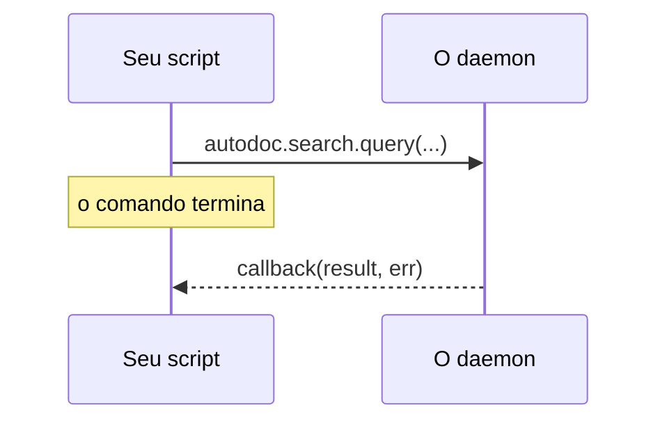

# O Lua chama o daemon

Um script pode pedir ao daemon o mesmo que a TUI pede: buscar, ler um arquivo, listar os espaços de trabalho. Cada verbo que o daemon oferece aos scripts é uma função sob `autodoc`, com o mesmo nome:

```lua
autodoc.command{ name = "kestrels", run = function(ed)
  autodoc.search.query("kb", "kestrel", {limit = 5}, function(res, err)
    if err then autodoc.notify("search failed: " .. err) return end
    autodoc.notify(#res.hits .. " hits; the first is " .. res.hits[1].path)
  end)
end }
```

**A resposta vem depois.** A chamada retorna na hora, e a resposta do daemon vai para o callback, o último argumento: `function(result, err)`. A essa altura o comando já terminou, então o trabalho acontece no callback. Ele roda como um comando: dois segundos, `ed` acessível, as edições num único desfazer. A página pode ter mudado nesse meio-tempo, então leia as posições de novo ali.



**Os parâmetros** são os do verbo, em ordem; os opcionais no fim podem ser omitidos. Passar o número errado de parâmetros dá erro na própria chamada, e a mensagem os nomeia. Uma tabela com as chaves 1, 2, 3… vai como lista, qualquer outra como mapa, e números sem parte decimal como inteiros; o resultado volta como tabelas Lua.

**`autodoc.current_workspace()`** é o espaço de trabalho em uso (nil antes de entrar em um): o primeiro parâmetro que a maioria dos verbos recebe.

**`autodoc.call(verb, params, cb)`** chega a um verbo pelo nome, com os parâmetros como lista: `autodoc.call("doc.read", {"kb", "a.md"}, cb)`. As funções no estilo de `autodoc.search` são criadas quando o AutoDoc se conecta, a partir do daemon em que ele está: use-as dentro de `run`, não no topo de um arquivo.

**Quais verbos?** `autodoc --contracts` imprime todos os verbos, os parâmetros e o resultado de cada um; `autodoc --contracts 'search.*' --format md` imprime um domínio, como tabelas. Os verbos do próprio protocolo (`sys.hello`, `sys.shutdown`) são recusados aos scripts.

**Erros.** Uma chamada que falha chega ao callback como `err`, com o código e a mensagem do daemon: `"-32061 not found"` (`--contracts` lista os códigos). Sem callback, a falha vira uma notificação. O mesmo vale para um callback que falha ou demora demais: **SPC h** mostra todas elas.

Mais: [Referência, Capítulo 14: Scripts Lua e comandos personalizados](../../reference/14-lua-scripting-and-custom-commands.md).
