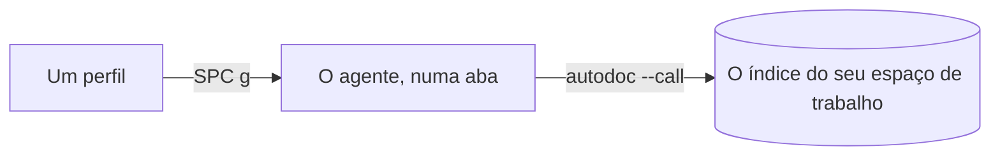

# O painel de agentes: agentes de IA ao lado das suas notas

O AutoDoc roda as linhas de comando de agentes de IA (Claude Code, Codex, OpenCode e outros) num painel próprio, cada um informado sobre o seu espaço de trabalho.

**Na primeira execução**, o AutoDoc se oferece para configurar um: ele encontra Claude Code, Codex, Grok ou Antigravity no seu PATH, e **Configurar** salva o perfil, inicia o agente e faz com que ele diga o que pode fazer por você. **Sistema › Configurar um agente…** traz esse cartão de volta.

**Adicione um perfil.** **Sistema › Perfis de agente…** (SPC G), depois **Adicionar…**: um nome e o comando que inicia o agente, como `claude --model opus` ou `codex`. `{root}` e `{workspace}` no comando viram a pasta e o nome do espaço de trabalho. O primeiro perfil é o padrão; **Tornar padrão** escolhe outro.

**SPC g** mostra o painel, iniciando o agente padrão se nenhum estiver rodando, e o esconde de novo. Um agente escondido continua rodando.

**Ele conhece o seu espaço de trabalho.** Um agente começa na pasta própria do AutoDoc para o espaço de trabalho, onde o AutoDoc escreve `AGENTS.md` e `CLAUDE.md`: o nome e a raiz do espaço de trabalho, e como chegar até ele. O `autodoc` no path dele é o seu, então `autodoc --call workspace.list` e os outros verbos chegam ao mesmo índice em que você busca.

**Abas.** Cada agente tem uma aba, com o nome do seu codinome. **+** inicia outro perfil, ou vai para um que já está rodando. O menu de uma aba (`≡`, ou um clique direito nas abas) tem **Ir para**, **Reiniciar**, **Fechar**, **Perfis…**, **Tema e fonte…**, **Maximizar** e **Esconder**.

**Dentro do painel**, toda tecla vai para o agente, Esc também. **Ctrl+T** passa para o modo Normal, para percorrer o histórico (`h j k l`, `/`, `v`, `y`); ali, Esc esconde o painel.

**Mande a sua página.** **SPC a** abre o cartão de agentes: **b** envia a página a um agente, **f** a seleção.

Na GUI, **Opções › Fontes e zoom…** define o tamanho do texto dos agentes, como uma fração do da janela, de 50% a 150%; o menu do painel (≡) o muda de 10% em 10% (**Tamanho do texto › Menor**, **Maior**). O painel de terminal o compartilha.

Mais: [Referência, Capítulo 11: Abas de terminal embutidas e entrega de tarefas a agentes com uma tecla](../../reference/11-terminal-tabs-and-agent-handoff.md) e [Referência, Capítulo 12: Integração com agentes de IA, recuperação adaptativa e RPC pela CLI](../../reference/12-ai-agent-integration-and-cli-rpc.md).
