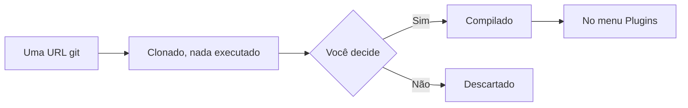

# Plugins: como adicionar e usar

Um **plugin** é um programa próprio que o AutoDoc roda: ele continua funcionando enquanto você escreve, desenha o próprio diálogo ou cartão e pode acessar arquivos, a rede e outras ferramentas. O AutoDB, uma bancada de SQL, é um deles.

**Adicione um.** **Plugins › Adicionar de uma URL git…**, depois o endereço do repositório, por exemplo `https://github.com/yongjohnlee80/autodb`.

1. O AutoDoc o clona e ainda não roda nada.
2. Ele mostra o que vai compilar e o que vai iniciar, e pergunta: **Sim, por minha conta e risco**, ou **Não, cancelar**. Um plugin roda como você, com os seus arquivos: adicione só plugins em que você confia. **Auditar…** antes faz um dos seus agentes ler o código; clique na notificação dele para voltar e decidir.
3. Sim o compila, e o plugin aparece no menu **Plugins**.

**Ou pelo registro.** **Plugins › Explorar o registro…** lista os plugins e pacotes Lua que o registro conhece, cada um com as suas auditorias. **Instalar** faz a mesma pergunta e diz se o commit que seria instalado foi auditado. **Adicionar de uma URL git…** também aceita um nome do registro.

**Três tipos.**

- Um **diálogo** abre sobre a página; Esc o fecha.
- Um **cartão** se encaixa ao lado da página e continua rodando enquanto escondido. O AutoDB é um cartão: ele roda a instrução sob o cursor, e as linhas vão para a tabela de resultados do AutoDoc. O item **Desligar** dele no menu Plugins o para.
- Um **serviço** não tem janela; ele trabalha em segundo plano.

**Os comandos dele.** O submenu de cada plugin no menu **Plugins** tem os comandos dele. **SPC p** lista os plugins que têm comandos: dê a um deles uma letra sua com `*`, depois aperte essa letra para ver os comandos, e a tecla de um comando o executa.

**Gerenciar plugins…** posiciona um plugin (à esquerda ou à direita, onde ele puder ficar), **Atualizar…** o leva à versão mais recente do repositório, fazendo a mesma pergunta de novo, e **Remover…** o exclui.

**Notificações.** Um plugin pode dizer o que fez, ou o que deu errado, como uma notificação no canto. **SPC h** guarda o histórico de todas elas.

Mais: [Referência, Capítulo 15: Arquitetura de plugins e registro](../../reference/15-plugin-architecture-and-registry.md) e [Referência, Capítulo 16: AutoDB, bancada de SQL ao vivo](../../reference/16-autodb-live-sql-workbench.md).
