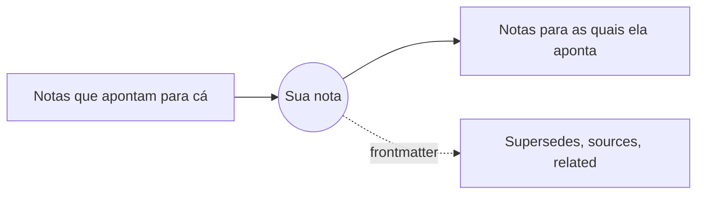

# Relações: Links, o Mindmap e o GlobeMap

As notas se ligam umas às outras: por links Markdown e pelo frontmatter (supersedes, sources, related…). O menu **Relações** mostra esses links de três jeitos.

**Links (SPC l).** Um painel com as conexões da nota aberta: para onde ela aponta, os backlinks dela e as relações do frontmatter, cada grupo sob o seu título. Links que não nomeiam nenhum documento também aparecem. **Enter** abre uma nota, e o painel fecha; **d** lista também as notas a dois links de distância. Todo terminal e toda janela têm esse painel.

**O Mindmap** (na GUI). A sua nota no centro, as notas a um link de distância em volta dela; **d** chega a dois. Clique numa nota para abri-la, e o mapa se centraliza nela.

**O GlobeMap** (na GUI). O espaço de trabalho inteiro de uma vez: todas as notas e todos os links, assentando no lugar enquanto você olha.

- arraste para mover a vista, use a roda do mouse ou **+** e **-** para o zoom, e **0** para enquadrar tudo de novo;
- **f** escolhe quais links aparecem: todos os links, os links do corpo ou as relações do frontmatter;
- **l** mostra ou esconde a legenda;
- clique numa nota para abri-la.

As cores vêm dos **grupos**, semeados a partir dos tipos do seu esquema e das suas pastas, para que a forma de um espaço de trabalho apareça num relance; a legenda os nomeia. **Relações › Configurações do GlobeMap…** e **Configurações do Mindmap…** escolhem como cada um é desenhado: o tema, as cores, os nomes e mais.

Mais: [Referência, Capítulo 8: Grafos de conhecimento e o ciclo de vida dos ADRs](../../reference/08-knowledge-graphs-and-adr-lifecycle.md).
