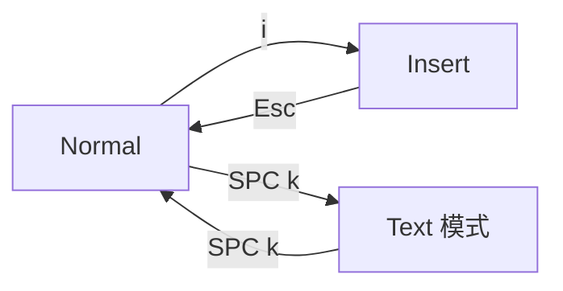

# 页面及其两种编辑器模式

AutoDoc 把文件作为**页面**打开：居中显示，宽度正好适合阅读，在你需要之前，屏幕上不会出现别的东西。

它以两种模式之一进行编辑。**SPC k**（选项 › 编辑器模式）在两者之间切换。

- **Vim**（默认）：模式化编辑。`i` 开始输入，`Esc` 回到 Normal 模式，Normal 模式下的按键用来移动和编辑：`h j k l`、`w b e`、`dd`、`yy`、`p`、`u`。`?` 显示 Vim 按键卡片。
- **Text**：无模式，使用普通编辑器的按键。直接输入即可，方向键移动光标，Ctrl+C、Ctrl+X、Ctrl+V 分别是复制、剪切和粘贴。

**前导键。** 在 Vim 的 Normal 模式下，**Space** 打开前导键卡片：每个命令对应一个键。在任何模式下，**Ctrl+Space** 都能打开它。下文介绍的大多数功能，都是这张卡片上的一个键。

**菜单栏**显示在顶部。若设为隐藏（选项 › 编辑器首选项），它会隐藏，按 **F10** 或 **Alt+字母键** 才会出现（在 Mac 上是 Option+字母键）。**SPC m** 显示菜单栏并让它一直显示。

**停靠栏**位于菜单栏的右端：每个打开的控件对应一个图标。**✎** 编辑器排在最前，后面是每个已打开的面板，以及抽屉虽已关闭、却仍在后台运行的面板：终端的 shell、智能体、插件卡片的插件。把鼠标指向图标即可看到它的名称。点击一个正在显示的面板会隐藏它；点击一个隐藏的面板，它会按你离开时的样子回来，键盘焦点也随之进入。隐藏的面板会保留其中的一切，图标会变暗。**✎** 隐藏所有正在显示的面板，再点一次，同样那些面板会重新出现。从 GlobeMap、Mindmap 或链接抽屉中打开笔记时，也会以同样的方式把它隐藏。只要停靠栏中不止编辑器一项，菜单栏就会一直显示，页面也会下移一行。

**Ctrl+S** 保存。**SPC o** 打开工作区中的文档，**Ctrl+N** 新建文档，**Ctrl+Q** 退出。在 Normal 模式下，**Ctrl+O** 回到你之前所在的位置（上一个链接或上一个文档），**Ctrl+I** 则再前进。

更多：[参考手册，第 3 章：模式化编辑器与面板](../../reference/03-modal-editor-and-panels.md)。
