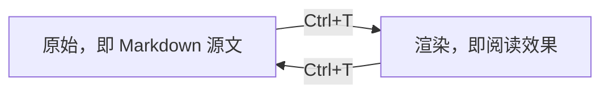

# 渲染视图：Ctrl+T

在 `autodoc --gui` 下，**Ctrl+T** 让页面在**原始**视图（按原样书写的 Markdown）和**渲染**视图之间切换：在渲染视图中，标题按各自的字号显示，标记符号被隐藏，表格、代码和 Mermaid 图表都会绘制出来。

渲染视图仍然是编辑器。每一行都可以编辑：光标所在的行显示它的 Markdown，其余各行显示它们呈现出的效果。再按一次 Ctrl+T 回到原始视图。

**HTML 文件**会先询问如何打开：**简化**，以只读方式显示其文本；或**原始**，直接编辑并保存 HTML 本身。原始 HTML 文件的渲染视图就是它的网页，以原生方式绘制，并带有它自己的样式表和图片：`j k` 滚动，其中的链接可以打开笔记、文件和浏览器。

**文件 › 预览 HTML**（SPC H）在编辑器旁打开笔记的网页，随你的输入实时更新。

**右键菜单**：撤销、重做、复制、剪切、粘贴、查看图表、转到链接、后退，在 GUI 中还有缩放。用键盘打开它：**Shift+F10**、键盘上的 **Menu** 键（如果有的话），或 **SPC .**。

终端没有渲染视图：在终端中，页面始终是原始视图。

更多：[参考手册，第 4 章：富文本创作、嵌入与导出](../../reference/04-rich-authoring-embeds-and-export.md)。
