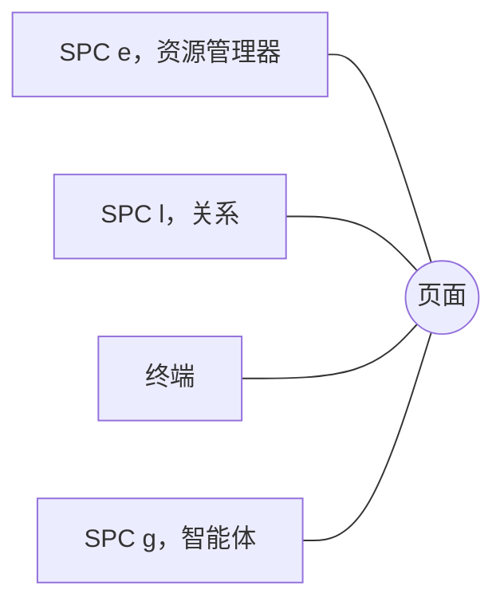

# 搜索与面板

**Ctrl+G**（或 SPC SPC、SPC /）按词语搜索工作区，有模型时还能按语义搜索：命中结果在左侧，右侧显示命中位置所在的文件。按 Enter 打开它。

**/** 在你所在的窗格中查找词语；**n** 和 **N** 再次查找。

**面板**在页面上方打开，页面本身从不在它们下面移动：

- **SPC e** 资源管理器：所有工作区的文件夹和文件
- **SPC l** 关系：此文件链接到哪些文件，以及哪些文件链接到它
- **SPC `** 终端，在工作区的文件夹中运行你的 shell
- **SPC g** AI 智能体的 CLI（系统 › 智能体配置…）

**Ctrl+h j k l**（Normal 模式）在页面和面板之间来回切换。

**每个面板都能移动和调整大小。** 按住 Alt（Mac 上为 Option）并用左键，可以把面板拖到任意位置；用右键则可以调整大小。**SPC L**（转到 › 排列面板…）用按键完成这两件事：`h j k l` 移动，`H J K L` 调整大小，Enter 保留，Esc 还原。之后面板会在你上次放置的位置打开；**转到 › 重置面板布局** 会把所有面板重新停靠回原处。

更多：[参考手册，第 3 章：模式化编辑器与面板](../../reference/03-modal-editor-and-panels.md)，以及[参考手册，第 5 章：混合搜索管线](../../reference/05-hybrid-search-pipeline.md)。
