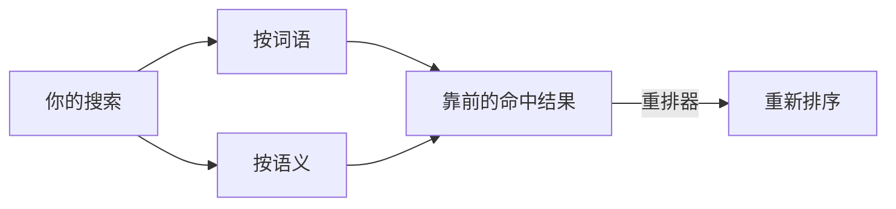

# 搜索模型：嵌入模型与重排器

没有模型时，搜索按词语进行。**系统 › 搜索模型…**（SPC s）用来添加按语义搜索的模型。它有两个标签页。

**Embedding Models**（嵌入模型）把文件的每个小节转换成向量，这样搜索就能找到*意思*相同的内容。

1. **添加…** 一个提供方：带嵌入模型的本地 **Ollama**（`ollama pull nomic-embed-text`）、**Ollama Cloud**，或任何带密钥的**兼容 OpenAI** 的端点。
2. **使用**它。工作区会在后台建立索引，状态栏的标记会显示正在搜索的模型。
3. **取消索引** 可中止漫长的首次索引；**仅词语** 则回到按词语搜索。

**Ranker Models**（重排模型）是第二阶段：重排器对照你的问题阅读排名靠前的命中结果，再重新排序。

1. **添加…** 一个重排器：填写它的类型、基础 URL 和模型；**检查** 会试用它。
2. **使用**它。**窗口…** 设置它阅读多少条靠前的命中结果。

搜索中的复选框（词法、语义、重排）决定每次搜索使用哪些阶段。

更多：[参考手册，第 6 章：配置嵌入模型与重排器](../../reference/06-configuring-embeddings-and-rerankers.md)。
