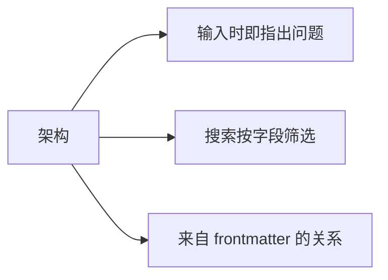

# 工作区及其架构

**工作区**是 AutoDoc 为其建立索引的文件夹：索引其中的 Markdown、文本和 YAML 文件，跳过 `.git`。

- **Ctrl+W**（SPC w）切换工作区。在 Vim 编辑器模式的 Insert 模式下，Ctrl+W 保持 Vim 的原义，删除一个词：请先按 Esc。
- **管理…**（SPC W）可以添加工作区（名称及其文件夹），也可以重命名、编辑或删除工作区。删除只会移除索引，文件仍然保留。
- `autodoc --ui <name>` 打开该工作区；不带名称时，打开上次使用的工作区。

**架构**说明文档的 frontmatter 包含什么：有哪些字段、字段的类型，以及可以取哪些值。在 **管理… › 编辑…** 中为工作区指定架构：填写文件名，建议用 `.autodoc/schema.yaml`。

有了架构：

- 页面上方的提示行会在你输入时指出文件的 frontmatter 问题，但从不阻止保存；
- 搜索可以按字段筛选：`type:adr` 会找出所有 ADR；
- 关系面板能识别 frontmatter 建立的链接：supersedes、sources、amends、related。

没有架构时，`field:value` 会按普通词语搜索。

更多：[参考手册，第 7 章：Frontmatter 架构与验证](../../reference/07-frontmatter-schemas-and-validation.md)。
