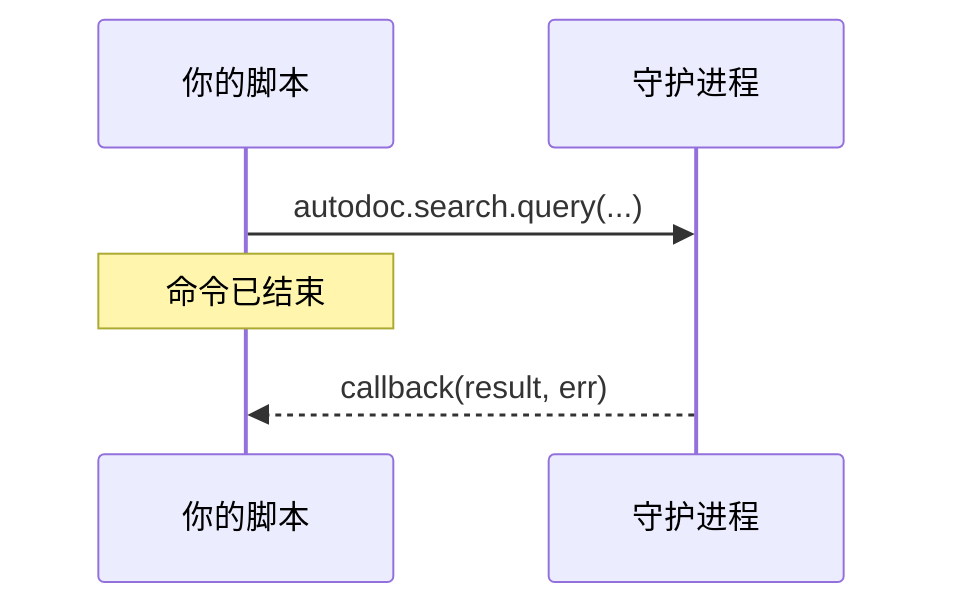

# 用 Lua 调用守护进程

脚本可以向守护进程询问 TUI 会问的那些事：搜索、读取文件、列出工作区。守护进程向脚本开放的每个动词（verb），都是 `autodoc` 下与之同名的一个函数：

```lua
autodoc.command{ name = "kestrels", run = function(ed)
  autodoc.search.query("kb", "kestrel", {limit = 5}, function(res, err)
    if err then autodoc.notify("search failed: " .. err) return end
    autodoc.notify(#res.hits .. " hits; the first is " .. res.hits[1].path)
  end)
end }
```

**应答稍后才到。** 调用会立即返回，守护进程的应答则交给回调，也就是最后一个参数：`function(result, err)`。应答到达时命令早已结束，所以实际工作要在回调中完成。回调的运行方式与命令相同：两秒时限，可以访问 `ed`，其中的编辑算作一次撤销。这期间页面可能已经改变，所以要在回调中重新读取位置。



**参数**就是该动词的参数，按顺序排列；末尾的可选参数可以省略。参数个数不对会在调用时报错，并列出各参数名。键为 1、2、3… 的表按列表传递，其他表按映射传递，整数按整数传递；结果以 Lua 表的形式返回。

**`autodoc.current_workspace()`** 是当前使用的工作区（进入工作区之前为 nil），也是大多数动词的第一个参数。

**`autodoc.call(verb, params, cb)`** 按名称调用动词，参数以列表形式给出：`autodoc.call("doc.read", {"kb", "a.md"}, cb)`。`autodoc.search` 这类函数是 AutoDoc 连接守护进程时，根据所连的守护进程生成的：请在 `run` 内使用它们，而不要在文件顶层使用。

**有哪些动词？** `autodoc --contracts` 打印每个动词及其参数和结果；`autodoc --contracts 'search.*' --format md` 以表格形式打印某一个域。协议自身的动词（`sys.hello`、`sys.shutdown`）不允许脚本调用。

**错误。** 调用失败时，`err` 会送达回调，内容是守护进程的错误码和消息：`"-32061 not found"`（`--contracts` 会列出这些错误码）。没有回调时，失败会显示为一条通知。回调本身失败或运行太久时也是如此：**SPC h** 会显示所有这些通知。

更多：[参考手册，第 14 章：Lua 脚本与自定义命令](../../reference/14-lua-scripting-and-custom-commands.md)。
