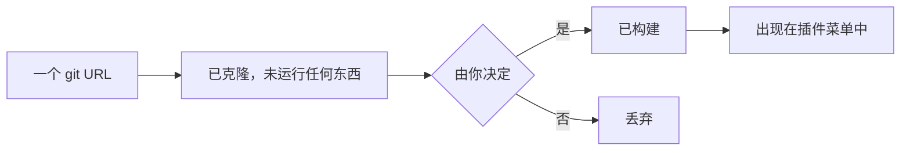

# 插件：添加与使用

**插件**是由 AutoDoc 运行的独立程序：你写作时它一直在运行，绘制自己的对话框或卡片，并且能访问文件、网络和其他工具。SQL 工作台 AutoDB 就是一个插件。

**添加插件。** **插件 › 从 git URL 添加…**，然后输入仓库地址，例如 `https://github.com/yongjohnlee80/autodb`。

1. AutoDoc 克隆仓库，但暂时不运行任何东西。
2. 它会显示将要构建什么、将要启动什么，然后询问你：**是，风险自负**，或**否，取消**。插件以你的身份运行，能访问你的文件：只添加你信任的插件。**审计…** 会先让你的某个智能体阅读代码；点击它发出的通知，即可回来做决定。
3. 选“是”就会构建插件，之后插件出现在 **插件** 菜单中。

**也可以从注册中心添加。** **插件 › 浏览注册中心…** 列出注册中心收录的插件和 Lua 包，每一项都附有其审计记录。**安装** 会问同样的问题，并说明将要安装的提交是否经过审计。**从 git URL 添加…** 也接受注册名称。

**三种类型。**

- **对话框**在页面上方打开；按 Esc 关闭。
- **卡片**停靠在页面旁边，隐藏时仍继续运行。AutoDB 就是一张卡片：它运行光标下的语句，结果行进入 AutoDoc 的结果表。插件菜单中它的 **关闭**项可以停止它。
- **服务**没有窗口，在后台工作。

**它的命令。** **插件** 菜单中，每个插件的子菜单列出了它的命令。**SPC p** 列出带命令的插件：用 `*` 给某个插件指定一个你自己的字母，之后按这个字母就能看到它的命令，再按命令对应的键即可运行。

**管理插件…** 用来放置插件（左侧或右侧，视它允许的位置而定），**更新…** 把插件更新到仓库的最新版本（会再次询问同样的问题），**移除…** 则删除插件。

**通知。** 插件可以在角落里以通知的形式告诉你它做了什么，或出了什么问题。**SPC h** 保存所有通知的历史。

更多：[参考手册，第 15 章：插件架构与注册中心](../../reference/15-plugin-architecture-and-registry.md)，以及[参考手册，第 16 章：AutoDB 实时 SQL 工作台](../../reference/16-autodb-live-sql-workbench.md)。
