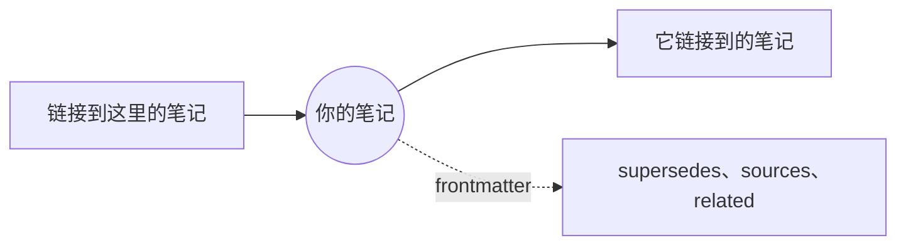

# 关系：链接、Mindmap 与 GlobeMap

笔记之间相互链接：通过 Markdown 链接，也通过 frontmatter（supersedes、sources、related…）。**关系** 菜单以三种方式展示这些链接。

**链接（SPC l）。** 一个显示当前笔记各种关联的面板：它链接到的笔记、它的反向链接，以及它的 frontmatter 关系，各自列在单独的标题下。未指向任何文档的链接也会列出。**Enter** 打开笔记并关闭面板；**d** 还会列出两跳之外的笔记。所有终端和窗口中都可以使用。

**Mindmap**（GUI 中）。你的笔记位于中心，一跳之内的笔记环绕四周；**d** 扩展到两跳。点击某篇笔记即可打开它，导图也会随之以它为中心。

**GlobeMap**（GUI 中）。一次呈现整个工作区：每篇笔记、每条链接，在你眼前逐渐各就其位。

- 拖动可平移，鼠标滚轮或 **+** 和 **-** 可缩放，**0** 重新缩放到能看到全部内容；
- **f** 选择显示哪些链接：全部链接、正文中的链接，或 frontmatter 关系；
- **l** 显示或隐藏图例；
- 点击笔记即可打开它。

颜色来自**分组**，分组的初始设置取自架构中的类型和你的文件夹，因此工作区的结构一目了然；图例会标出各个分组。**关系 › GlobeMap 设置…** 和 **Mindmap 设置…** 分别选择两者的绘制方式：主题、颜色、名称等。

更多：[参考手册，第 8 章：知识图谱与 ADR 生命周期](../../reference/08-knowledge-graphs-and-adr-lifecycle.md)。
